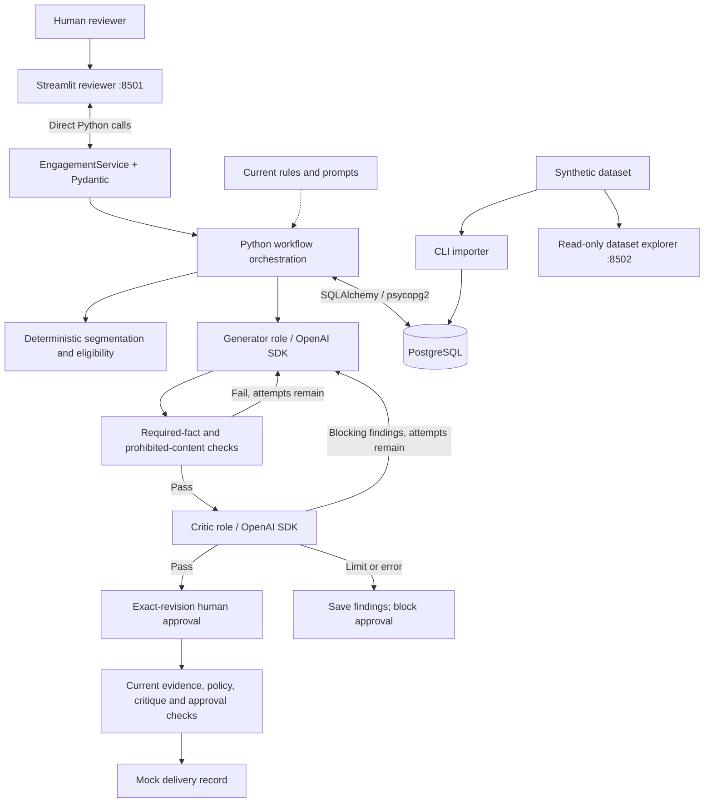

# Implemented architecture: generator–critic loop

The application is a modular Python backend with a Streamlit reviewer, PostgreSQL persistence, and two LLM roles using the configured OpenAI model. The default project configuration uses `gpt-6-astra` with reasoning effort `high`. Generator and critic have separate prompts and structured output schemas.

| Technology | Role | Connection |
|---|---|---|
| Python 3.11+ | Backend and UI language | Runs the application modules |
| Streamlit | Reviewer and dataset dashboards | Reviewer calls `EngagementService` directly; dataset explorer reads fixture files |
| Python application service | Validation, transactions and safe errors | Calls the workflow in the Streamlit server process |
| Pydantic | Input and output contracts | Validates service inputs and generator/critic responses |
| OpenAI Python SDK / Responses API | Generator and critic calls | Backend-only credentials; structured output; `store=False` |
| SQLAlchemy | Database access and transactions | Uses psycopg2 to access PostgreSQL |
| PostgreSQL | Seven persistent application tables | Stores profiles, decisions, revisions, reviews, delivery records and audit events |
| Current JSON configuration | Business rules, message templates, agent prompts and loop limit | Frozen into each evaluation snapshot |
| Pytest | Component, service, UI and concurrency checks | Isolated SQLite fixtures and opt-in PostgreSQL schemas |

The five strategy rules are described in [Simple rules](SIMPLE_RULES.md). Policy/content files update in place. Frozen snapshots and content hashes detect changes; fresh evaluation and approval are required after an update.

## Agent responsibilities

The generator's first request receives the policy-selected objective and tone. Code inserts all verified message facts. Repairs receive critic findings and, when appropriate, the previous generated courtesy copy. The generator outputs only `opening` and `closing` (each at most 240 characters). It cannot change facts, strategy, eligibility, reminder severity or permissions.

The critic independently assesses the complete draft against the selected verified facts, objective and tone. The customer name is replaced with `[customer]`. Full customer profiles, contact information, feedback and unrelated offers stay local. Its response contains a pass/revise verdict and bounded findings: category, severity, quoted text, explanation and suggested correction. The critic treats embedded draft instructions as data and cannot authorize delivery.

The prompts are `generation.system_prompt` and `critique.system_prompt` in `app/policies/content.json`. Their current versions are `courtesy-copy-v2` and `telecom-critique-v1`. Both roles use the backend's `OPENAI_MODEL` and `OPENAI_REASONING_EFFORT` settings.

## Loop and review behavior

1. Generate and save a candidate revision.
2. Run deterministic checks. On failure, skip the critic and feed the rule findings to the next generator attempt.
3. Critique a candidate that passed the rules. Save the model, prompt, verdict and findings against that exact revision.
4. If the critic requests changes, send its feedback to the generator for another candidate. Stop after at most three candidates, or earlier on a pass or model error.
5. Require both rule checks and critique to pass before human approval. Failed attempts remain in revision history.
6. A human edit creates a new revision and gets a new critique. The application never automatically overwrites the human's edit.
7. Approval and delivery check the saved assessment's input fingerprint, message hash and policy hash. They do not make additional model requests.

The loop runs synchronously inside one service transaction under the existing customer/run locks. Streamlit waits for the direct Python call, with up to six model calls and a 45-second timeout on each model call. A critic refusal, invalid output or API error stops the cycle and leaves approval blocked. **Run AI critique** retries an assessment without changing text and invalidates earlier approval; **Regenerate with critique** explicitly starts another bounded cycle using the current findings. Durable background jobs and streaming progress are not implemented.

`app/service.py` is the application boundary for the reviewer and smoke script. Streamlit caches one service and its SQLAlchemy engine pool; each service operation opens and closes an independent session. Successful mutations commit atomically. Workflow refusals commit their hold/audit records, while database failures roll back and return a safe `ServiceError`. Detached results contain JSON-compatible values. The database URL and model credentials stay in the server process. Only the Streamlit reviewer on port 8501, optional dataset explorer on 8502, and configured PostgreSQL server need to run.

With OpenAI configured, template drafts receive one critique, but selecting a template does not start an LLM generator loop. Without a configured model/key, the explicitly labelled offline template demo uses only deterministic checks. Critique requirements already attached to a revision persist through edits and provider changes.

## Persistence and verification

The existing `message_revisions.validation` JSON stores critique results and iteration metadata. `audit_events` records revision creation, critique outcomes and loop completion. The other tables remain `customers`, `offers`, `engagement_runs`, `reviews` and `delivery_jobs`. No schema migration is needed for this extension.

`tests/test_critique.py` covers feedback-driven repair, a three-attempt stop, failed-rule repair, critic refusals/errors/malformed results, exact-message binding, retry behavior, human-edit preservation and approval/delivery blocking. Model calls in these tests are scripted, not live. `tests/test_ui.py` covers visible findings, explicit retry/regeneration actions and approval-button gating. Historical model-quality reports remain historical; passing workflow tests does not establish critic accuracy.

The integration uses [OpenAI structured outputs](https://developers.openai.com/api/docs/guides/structured-outputs); the application separately handles refusals, incomplete responses, API errors and business-rule validation.
